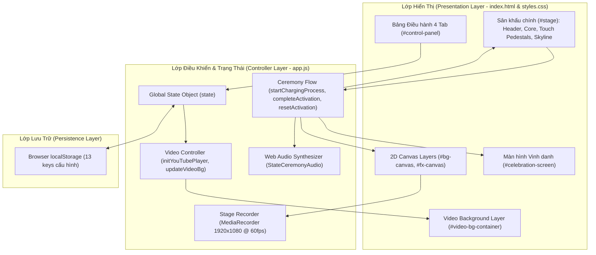
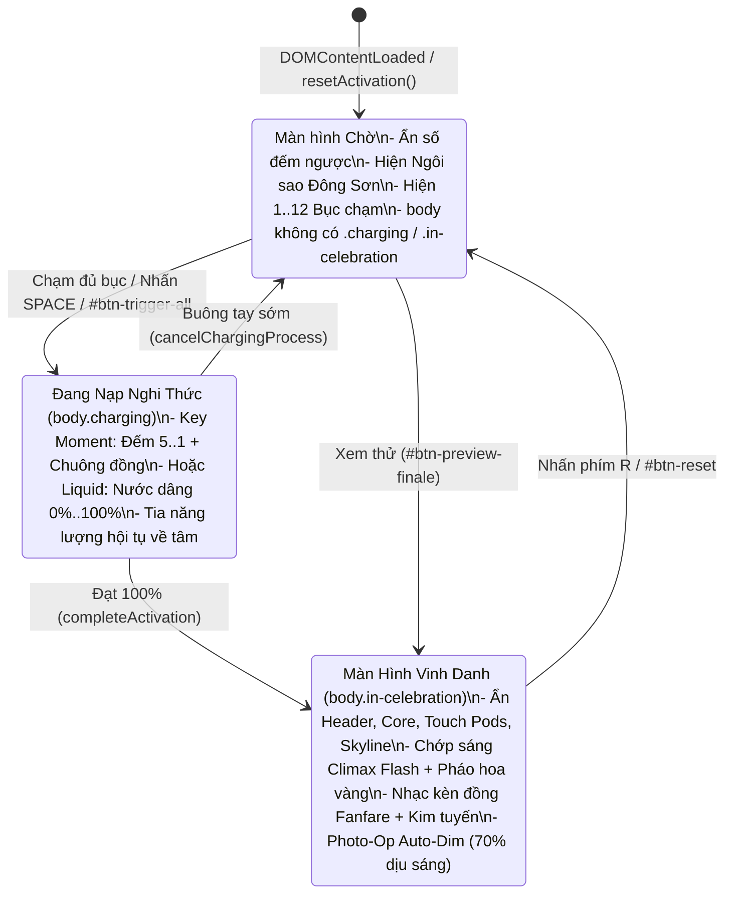

# TÀI LIỆU KIẾN TRÚC HỆ THỐNG (SYSTEM ARCHITECTURE)
**Dự án:** Ứng dụng Sân khấu LED — Nghi thức Kích hoạt Chuyển đổi số & Dịch vụ công Quốc gia  
**Phiên bản:** 1.0  
**Ngày cập nhật:** 16/11/2026  

---

## 1. Kiến Trúc Tổng Thể

Ứng dụng được thiết kế theo mô hình **Zero-Build Client-Side Architecture** gồm 3 tệp nguồn chính tại thư mục gốc (`index.html`, `styles.css`, `app.js`), vận hành hoàn toàn trên trình duyệt mà không cần máy chủ backend hay bước biên dịch.

---

## 2. Máy Trạng Thái Nghi Thức (State Machine)

Vòng đời một lượt trình diễn nghi thức trên sân khấu LED tuân theo 3 trạng thái chính được điều phối bằng class trên `document.body`:

---

## 3. Phân Lớp Hiển Thị CSS (`z-index` Layering)

Để đảm bảo video nền, hạt ánh sáng, tâm năng lượng, bục chạm và bảng kỹ thuật không bị che khuất lẫn nhau, `styles.css` quy định thứ tự phân lớp như sau:

| Thứ tự (`z-index`) | Thành phần | Vai trò |
| :--- | :--- | :--- |
| `0` | `#video-bg-container` | Lớp video nền YouTube (Overscan che UI YouTube) hoặc Video MP4 nội bộ. |
| `1` | `#bg-canvas`, `.ambient-aura` | Hạt vàng kim trôi nhẹ & hào quang nền lễ tiết. |
| `2` | `#video-tint-overlay`, `#city-skyline` | Lớp phủ tối tăng độ tương phản & đường viền đô thị thông minh. |
| `3` – `6` | `.stage-header`, `#core-hologram`, `#touch-zones` | Khu vực sân khấu tương tác chính (tự ẩn khi `body.in-celebration`). |
| `8` | `#fx-canvas` | Sóng xung kích (`StateShockwave`), pháo hoa & mưa kim tuyến (`GoldConfettiParticle`). |
| `15` | `#celebration-screen` | Màn hình Vinh danh hiển thị độc lập trên nền Trống Đồng khi `body.in-celebration`. |
| `90` | `#btn-floating-settings` | Nút bánh răng nhỏ góc màn hình để mở lại bảng kỹ thuật. |
| `100` | `#control-panel` | Bảng điều hành 4 Tab (ẩn hoàn toàn khi nhấn phím `H`). |
| `250` | `#climax-flash` | Lớp chớp sáng vàng kim chuyển cảnh tại thời điểm mở khóa 100%. |

---

## 4. Đặc Tả Dữ Liệu `state` & `localStorage`

Toàn bộ cấu hình sân khấu được lưu tập trung trong đối tượng `state` (`app.js`) và đồng bộ xuống `localStorage` qua **13 khóa** sau:

| Khóa `localStorage` | Kiểu dữ liệu | Mặc định | Ý nghĩa |
| :--- | :--- | :--- | :--- |
| `handCount` | `number` | `5` | Số lượng bục chạm đại biểu (`1` – `12`). |
| `podY` | `number` | `-60` | Độ cao dịch chuyển dãy bục chạm (`px`). |
| `podSize` | `number` | `110` | Đường kính mỗi bục chạm (`60` – `200px`). |
| `podGap` | `number` | `38` | Khoảng cách giữa các bục (`8` – `110px`). |
| `coreY` | `number` | `0` | Độ cao dịch chuyển tâm năng lượng (`px`). |
| `coreScale` | `number` | `1.0` | Tỷ lệ thu phóng tâm năng lượng. |
| `animationStyle` | `string` | `'keymoment'` | Kiểu hoạt ảnh trung tâm: `'keymoment'` hoặc `'liquid'`. |
| `youtubeVideoId` | `string` | `'sbDz4hoZWCk'` | ID video YouTube nền (tự di trú `'qyW8818wHhA'` → `'sbDz4hoZWCk'`). |
| `masterVolume` | `number` | `0.8` | Âm lượng tổng Web Audio (`0.0` – `1.0`). |
| `screenBrightness` | `number` | `72` | Độ sáng màn LED (`40` – `100%`), mặc định `72%` chống cháy sáng mặt. |
| `autoPhotoOpDim` | `boolean` | `true` | Tự động cân bằng sáng dịu khi vào màn hình Vinh danh. |
| `showHeader` | `boolean` | `false` | Ẩn/hiện tiêu đề sự kiện ở đầu sân khấu (`false` để nền Trống Đồng sạch). |
| `customLogoData` | `string` (Data URL) | `null` | Ảnh Logo đơn vị (PNG) tải lên từ máy tính. |

---

## 5. Chi Tiết Các Phân Hệ Trong `app.js`

### 5.1 Video Background Controller
- **`extractYouTubeId(urlOrId)`**: Phân tích URL YouTube (`watch?v=`, `youtu.be/`, `embed/`, `shorts/`) hoặc ID thô, mặc định trả về `'sbDz4hoZWCk'`.
- **`initYouTubePlayer()`**: Khởi tạo `YT.Player` với tham số `autoplay: 1`, `mute: 1`, `loop: 1`, `controls: 0`. Bắt sự kiện `onError`: nếu gặp mã `101`, `150` (chặn nhúng) hoặc `2`, tự động chuyển về `'sbDz4hoZWCk'` và lưu lại `localStorage`.
- **`updateVideoBg()`**: Điều phối hiển thị giữa nguồn YouTube và `<video id="local-video-player">` nội bộ cùng độ mờ (`videoOpacity`) và độ phủ tối (`tintDarkness`).

### 5.2 Hệ Thống Âm Thanh (`StateCeremonyAudio`)
- Xây dựng thuần bằng `AudioContext` và `GainNode` (`masterGain`), không cần tải tệp `.mp3`/`.wav`:
  - `playTouchChime()`: Âm chuông thanh nhã (B5 → E6) khi chạm từng bục.
  - `playCountdownBeep(num)`: Kết hợp sub-bass kick drum + âm vang chuông đồng cho mỗi nhịp đếm `5..1`.
  - `playFanfare()`: Hợp âm kèn đồng khánh tiết khi kích hoạt thành công.

### 5.3 Đồ Họa Canvas 2D & Ghi Hình Dự Phòng
- **`renderBg()`**: Vẽ các hạt ánh sáng vàng kim lơ lửng nền sân khấu trên `#bg-canvas`.
- **`renderFX()`**: Vẽ tia năng lượng hội tụ từ từng bục chạm về tâm khi đang nạp, vòng sóng xung kích (`StateShockwave`), pháo hoa (`triggerStageFirework`, `triggerStateExplosion`) và mưa kim tuyến (`GoldConfettiParticle`) trên `#fx-canvas`.
- **Ghi hình Video Canvas**: Ghép hai lớp `#bg-canvas` và `#fx-canvas` lên một `<canvas>` 1920×1080 dùng `captureStream(60)` + `MediaRecorder` (`video/webm;codecs=vp9` hoặc `video/webm`) để tải xuống tệp dự phòng phát trên vMix/Resolume.

